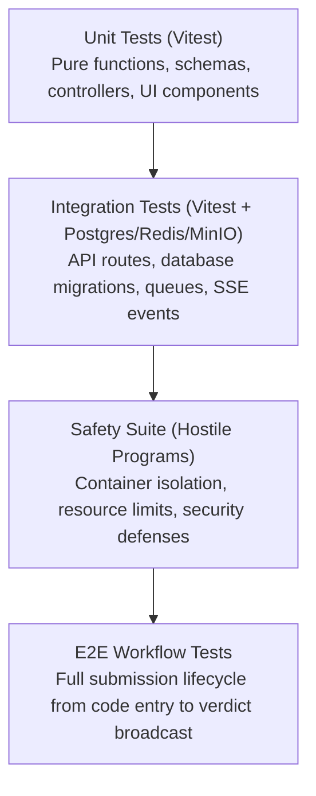

# Online Code Judge — Testing Strategy & Verification Guide

This document details the test suites, verification procedures, automated quality checks, and continuous integration pipeline for the Online Code Judge platform.

---

## 1. Test Architecture Overview

The platform implements a multi-tier testing strategy:

---

## 2. Test Execution Commands

| Target                | Command                 | Description                                                                                      |
| :-------------------- | :---------------------- | :----------------------------------------------------------------------------------------------- |
| **All Unit Tests**    | `pnpm test`             | Runs all non-integration tests across shared, API, frontend, and worker packages.                |
| **Integration Tests** | `pnpm test:integration` | Runs full database, API, Redis Pub/Sub, and MinIO integration tests against live local services. |
| **Safety Suite**      | `pnpm test:safety`      | Runs security attack programs against the Docker execution sandbox.                              |
| **Typecheck**         | `pnpm typecheck`        | Strict TypeScript verification across all workspace packages.                                    |
| **Linting**           | `pnpm lint`             | ESLint rules check with zero allowed warnings.                                                   |
| **Code Formatting**   | `pnpm format:check`     | Prettier formatting verification.                                                                |

---

## 3. Seven-Language Verification Matrix

All 7 supported programming languages have verified compilation and execution pipelines:

| Language       | Runtime / Compiler   | Test File                | Verified Verdicts        |
| :------------- | :------------------- | :----------------------- | :----------------------- |
| **JavaScript** | Node.js 20           | `multi-language.test.ts` | AC, WA, TLE, MLE, RE     |
| **Python**     | Python 3.11          | `multi-language.test.ts` | AC, WA, TLE, MLE, RE     |
| **C**          | GCC (C17 / C11)      | `multi-language.test.ts` | AC, WA, TLE, MLE, CE, RE |
| **C++**        | G++ (C++20 / C++17)  | `multi-language.test.ts` | AC, WA, TLE, MLE, CE, RE |
| **Java**       | OpenJDK 21           | `multi-language.test.ts` | AC, WA, TLE, MLE, CE, RE |
| **Go**         | Go 1.22              | `multi-language.test.ts` | AC, WA, TLE, MLE, CE, RE |
| **Rust**       | Rustc (2021 Edition) | `multi-language.test.ts` | AC, WA, TLE, MLE, CE, RE |

---

## 4. Continuous Integration (GitHub Actions)

The CI workflow (`.github/workflows/ci.yml`) executes on every push and pull request to `main` and `feature/*` branches:

1. **Job 1: Lint, Format & Typecheck**:
   - `pnpm format:check`
   - `pnpm lint`
   - `pnpm typecheck`
2. **Job 2: Unit Tests**:
   - Runs `pnpm test` (38 test suites, 330+ tests).
3. **Job 3: Integration Tests**:
   - Spins up PostgreSQL 16, Redis 7, and MinIO services with healthchecks.
   - Runs `pnpm db:migrate`.
   - Runs `pnpm test:integration`.
4. **Job 4: Production Docker Builds**:
   - Builds independent production images for API, Worker, and Frontend using Docker Buildx.
