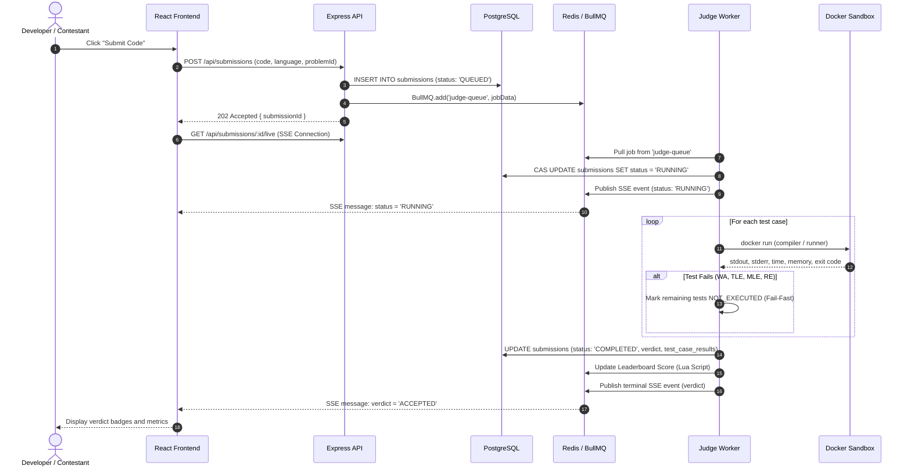

# Online Code Judge — Comprehensive Architecture Document

This document describes the complete system architecture, operational flows, data persistence, and security boundaries across all 6 development phases of the **Online Code Judge** platform.

---

## 1. System Architecture Overview

The platform uses an event-driven, microservices-style topology designed for high availability, deterministic evaluation, and strict security isolation:

```mermaid
flowchart TD
    subgraph Client ["Client Presentation Tier"]
        Browser["React 18 SPA (Monaco Editor, Tailwind CSS, SSE Client)"]
    end

    subgraph Gateway ["Ingress & Reverse Proxy"]
        Nginx["Nginx 1.27 Reverse Proxy (Port 80/443)"]
    end

    subgraph Services ["Application Services"]
        API["Backend API (@judge/api)<br/>Express + TypeScript + Drizzle"]
        Worker["Judge Worker (@judge/worker)<br/>Node.js + BullMQ Consumer"]
        Cron["Cron Service (@judge/cron)<br/>Scheduled Maintenance & Cleanup"]
    end

    subgraph DataTier ["Persistence & Messaging Tier"]
        Postgres[("PostgreSQL 16<br/>Relational Database + JSONB Results")]
        Redis[("Redis 7<br/>BullMQ Queues, Caching, Pub/Sub, Locks")]
        MinIO[("MinIO S3<br/>Test Case Object Storage")]
    end

    subgraph SandboxTier ["Isolated Execution Tier"]
        DockerHost["Docker Engine (/var/run/docker.sock)"]
        Sandbox["Ephemeral Sandboxes<br/>(Node 20, Python 3.11, GCC, G++, Java 21, Go 1.22, Rustc)"]
    end

    Browser <-->|HTTP REST & Cookies| Nginx
    Browser <-->|Server-Sent Events| Nginx
    Nginx -->|Reverse Proxy /api/| API
    Nginx -->|Static Assets /| Browser

    API <-->|SQL Queries / Schema| Postgres
    API <-->|Queues, Caching, SSE Pub/Sub| Redis
    API <-->|Testcase Uploads| MinIO

    Worker <-->|BullMQ Jobs (judge & sample-run)| Redis
    Worker <-->|Status & Verdict Updates| Postgres
    Worker <-->|Testcase Downloads| MinIO
    Worker -->|Container Spawn| DockerHost
    DockerHost -->|Disposable Run| Sandbox
```

---

## 2. Platform Capabilities by Phase

### Phase 1 — Multi-Language Compiler & Secure Sandbox

- **7 Supported Languages**:
  1. JavaScript (Node.js 20)
  2. Python (Python 3.11)
  3. C (GCC 13, C17/C11 standards)
  4. C++ (G++ 13, C++20/C++17 standards)
  5. Java (OpenJDK 21)
  6. Go (Go 1.22)
  7. Rust (Rustc 2021 edition)
- **Unified Sandbox Runner**: Ephemeral Docker containers with zero network (`--network none`), read-only rootfs (`--read-only`), PID caps (`--pids-limit 64`), memory caps (`--memory 512m`), CPU quotas, and dropped capabilities (`--cap-drop ALL`).

### Phase 2 — Custom Input & Testcase Result Persistence

- **Sample Run Execution**: Dedicated `sample-run-queue` for fast, lightweight custom code execution without modifying leaderboard standing.
- **Persistent JSONB Results**: Detailed per-test-case results stored in PostgreSQL `submissions.test_case_results` (status, verdict, execution time, memory used).
- **Hidden Test Case Sanitization**: Strict protection preventing input/output leakage for hidden test cases.
- **Fail-Fast Evaluation**: Remaining test cases marked `NOT_EXECUTED` after the first failing test to preserve worker compute.

### Phase 3 — Advanced Coding Workspace

- **Three-Panel Layout**: Resizable split panels for Problem Statement, Monaco Editor, and Test Runner / Output.
- **Dual Execution Modes**: "Run Code" (sample testcases / custom input) and "Submit" (official grading against full hidden test suite).
- **Draft Autosave & Recovery**: Local storage persistence for user code drafts across problem navigation and reloads.

### Phase 4 — Submission History & Source Inspector

- **Comprehensive History**: Filter submissions by search, verdict (AC, WA, TLE, etc.), programming language, and date range.
- **Source Code Inspector**: Read-only Monaco code viewer with one-click copy, syntax highlighting, and execution breakdown.
- **URL Parameter Synchronization**: Bookmarking and shareable filter states with a 300ms debounced search input.

### Phase 5 — User Analytics & Performance Dashboard

- **Dedicated Route (`/analytics`)**: Overview cards displaying total submissions, unique problems solved, global rank, and accuracy rate.
- **Visual Analytics**: Acceptance rate radial gauge, difficulty breakdown progress bars (Easy, Medium, Hard), verdict distribution chart, and language usage breakdown.
- **Interactive Activity Heatmap**: 52-week calendar heatmap tracking daily submissions and accepted solutions with hover tooltips.
- **Performance Trends**: Runtime and memory consumption tracking across recent accepted solutions.

### Phase 6 — Production Readiness, Security & CI

- **Docker Production Images**: Multi-stage Dockerfiles for API, Worker, and Frontend with zero extraneous host files via `.dockerignore`.
- **Automated CI Workflow**: GitHub Actions pipeline covering linting, formatting, TypeScript typechecking, unit tests, integration tests with containerized PostgreSQL/Redis/MinIO, and image builds.
- **Zero-Tolerance Security**: Automated `attack-suite/` verifying immunity against fork bombs, memory exhaustion, network egress, filesystem escapes, and output flooding.

---

## 3. Data Flow & Execution Lifecycle


