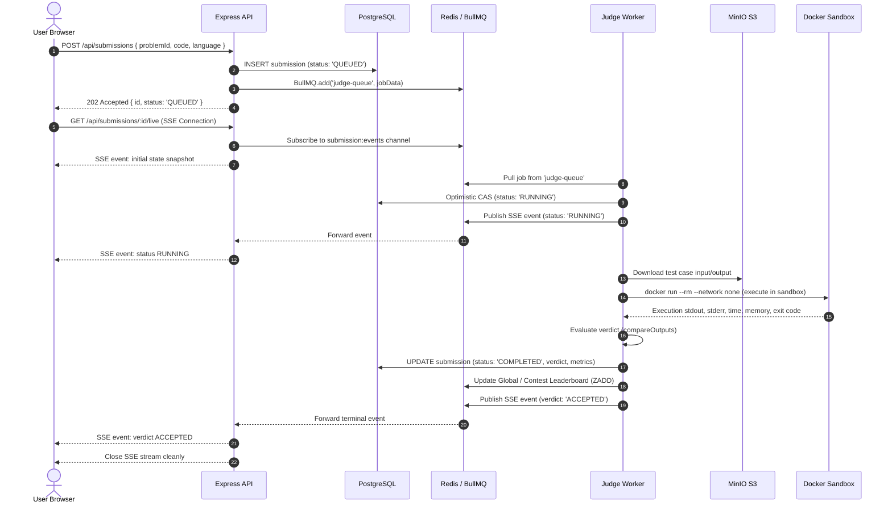

# Online Code Judge — System Architecture

This document describes the high-level and component architecture of the **Online Code Judge** platform, detailing system interactions, data flows, persistence models, and security boundaries.

---

## 1. System Overview

The platform is architected as an asynchronous, event-driven, local-first system designed for security, scalability, and deterministic code evaluation. It decouples high-throughput web traffic from compute-heavy, untrusted code evaluation using message queues, caching, and throwaway Docker execution sandboxes.

```mermaid
flowchart TD
    subgraph Client ["Client Layer"]
        Browser["User Browser (React 18 + Vite SPA)"]
    end

    subgraph Gateway ["Reverse Proxy & Ingress"]
        Nginx["Nginx Reverse Proxy (Port 80/443)"]
    end

    subgraph Application ["Application Services"]
        API["Backend API (@judge/api)<br/>Express + TypeScript"]
        Worker["Judge Worker (@judge/worker)<br/>Node.js + BullMQ Consumer"]
        Cron["Cron Service (@judge/cron)<br/>Scheduled Maintenance"]
    end

    subgraph Data ["Data & Storage Layer"]
        Postgres[("PostgreSQL 16<br/>Drizzle ORM Relational DB")]
        Redis[("Redis 7<br/>BullMQ Queues, Caches, Pub/Sub, Locks")]
        MinIO[("MinIO / Silo<br/>S3-Compatible Object Storage")]
    end

    subgraph Sandbox ["Isolated Execution Environment"]
        DockerHost["Host Docker Engine (/var/run/docker.sock)"]
        SandboxA["judge-sandbox-*<br/>(Node 20 / Python 3.11 Container)"]
        SandboxB["judge-sandbox-*<br/>(Node 20 / Python 3.11 Container)"]
    end

    Browser <-->|HTTP REST & Cookies| Nginx
    Browser <-->|Server-Sent Events (SSE)| Nginx
    Nginx -->|Reverse Proxy /api/| API
    Nginx -->|Static Assets /| Browser

    API <-->|SQL Queries / Drizzle| Postgres
    API <-->|Queues, Caching, Pub/Sub| Redis
    API <-->|SigV4 Testcase Upload| MinIO

    Worker <-->|BullMQ Job Consumption| Redis
    Worker <-->|Status & Verdict Updates| Postgres
    Worker <-->|SigV4 Testcase Download| MinIO
    Worker -->|child_process.execFile| DockerHost

    DockerHost -->|Disposable Spawn| SandboxA
    DockerHost -->|Disposable Spawn| SandboxB

    API -.->|Pub/Sub Event Delivery| Browser
```

---

## 2. Core Components

### 2.1 Web Frontend (`apps/frontend`)

- **Technology**: React 18, Vite, TypeScript, Tailwind CSS, TanStack React Query, React Router v6.
- **Role**: Client Single-Page Application (SPA) providing problem browsing, Monaco code editor (`@monaco-editor/react`), run-sample execution, official submission with live status tracking, contest participation, notifications, and real-time standings.
- **Security**: Zero access tokens in browser storage (`localStorage` / `sessionStorage`). Authentication relies exclusively on `HttpOnly`, `SameSite=Lax` session cookies.

### 2.2 Backend API (`apps/api`)

- **Technology**: Node.js 20, Express, Drizzle ORM, Zod, Pino, Helmet, CORS.
- **Role**: Validates HTTP payloads, manages user identity, provides REST endpoints for problems and contests, schedules jobs onto BullMQ, streams live Server-Sent Events (SSE), and serves health probes (`/health/live`, `/health/ready`).
- **Resilience**: Centralized error sanitization (never leaks database stack traces), rate limiting, and atomic compensating transactions on queue failure.

### 2.3 Judge Worker (`apps/judge-worker`)

- **Technology**: Node.js 20, BullMQ, Docker CLI, Drizzle ORM.
- **Role**: Asynchronous compute consumer that pulls jobs from `judge-queue` (official submissions) and `sample-run-queue` (sample runs), fetches test cases from MinIO, executes user code inside disposable containers via Docker CLI, and writes final verdicts to PostgreSQL.
- **Reliability**: Atomic CAS job claiming, retry backoff for transient failures, and stale-job recovery sweeper (`SubmissionRecoveryService`).

### 2.4 Data Stores & Message Brokers

1. **PostgreSQL 16**: Relational source of truth for users, problems, test case metadata, submissions, contests, contest participants, and notifications. Managed via Drizzle ORM schema and migrations.
2. **Redis 7**:
   - **BullMQ**: `judge-queue` and `sample-run-queue` for reliable job dispatching and retries.
   - **Sorted Sets (`ZSET`)**: High-performance real-time global leaderboard and contest standings.
   - **Pub/Sub**: `submission:events`, `contest:updates`, and `notification:events` channels for SSE broadcasting.
   - **Distributed Locks**: Atomic lock tokens with renewal scripts for contest lifecycle and verdict reconciliation.
   - **Caches & Rate Limits**: Keyset caching and brute-force lockout counters.
3. **MinIO / Silo**: S3-compatible object storage storing hidden and sample testcase files (`.in` and `.out`), keeping large input/output payloads out of relational tables.

---

## 3. End-to-End Submission Lifecycle



---

## 4. Leaderboard & Contest Architecture

### 4.1 Global Leaderboard

- **Scoring**: Encoded as a composite score:
  $$\text{Score} = (\text{problemsSolved} \times 10^7) + (10^7 - 1 - \text{penaltySeconds})$$
- Stored in Redis Sorted Set `judge:leaderboard:global`. Higher scores sort first.
- Ties in score are broken deterministically by alphabetical username, then user ID.
- **Cache-Aside Fallback**: If Redis is empty or recovering, the API falls back to PostgreSQL `submissions` (`verdict = 'ACCEPTED'`), processing earliest solves first.

### 4.2 Contest Standings & Freeze Mechanism

- Contests define `startTime`, `endTime`, and optional `freezeTime`.
- **Pre-Freeze**: Submissions during active time update live contest standings visible to all participants.
- **Freeze Period**:
  - Regular participants see standings frozen at `freezeTime`.
  - Admins and problem setters continue seeing live, unfrozen standings (`Role.ADMIN`).
- **Post-Contest**: Standings automatically unfreeze once `endTime` passes.

---

## 5. Security & Isolation Boundaries

1. **Host-Worker Boundary**: The worker runs outside sandbox containers and interacts with the Docker CLI. It communicates with Redis, MinIO, and PostgreSQL.
2. **Worker-Sandbox Boundary**: Untrusted code runs inside disposable `judge-sandbox-*` containers with:
   - Complete network disablement (`--network none`)
   - Read-only root filesystem (`--read-only`)
   - RAM and swap caps (`--memory=128m --memory-swap=128m`)
   - Process caps to stop fork bombs (`--pids-limit=64`)
   - All capabilities dropped (`--cap-drop ALL`)
   - Non-root user (`--user 1000:1000`)
3. **Public Gateway Boundary**: In production (`docker-compose.prod.yml`), only Nginx publishes port 80/443. PostgreSQL, Redis, MinIO, and the API are isolated within an internal bridge network (`judge_network`).
